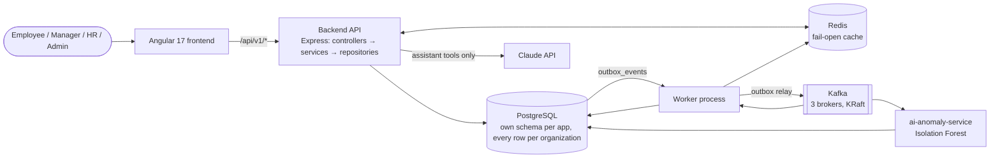
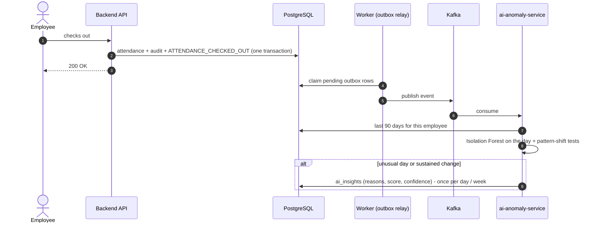

# SmartWorkforce AI

Workforce management platform for attendance, leave, WFH and regularization, with analytics, forecasting and AI features computed from real attendance/leave data rather than mocked numbers. Multi-tenant, role-based (Employee / Manager / HR / Admin), event-driven.


## Features

| Area | What you get |
|---|---|
| **Attendance** | Check-in/out with shifts and grace periods, late detection, team view, monthly calendar (holidays, leave, WFH), regularization requests for past days |
| **Leave & WFH** | Leave requests with per-type balances, carry-forward and per-organization leave policies; WFH requests with a per-organization monthly quota; approvals with row locking (no double approval) |
| **Workforce analytics** | Attendance trends, department comparison, work mode (office/WFH), overtime, approval turnaround (median, p90, SLA), employee lifecycle (joiners, exits, attrition, tenure), leave utilization, personal summary |
| **KPI engine** | Daily KPIs per organization and department, kept up to date from events; long-range trends by day / week / month |
| **Reports** | Attendance and leave summary reports generated in the background, stored, downloadable as CSV; monthly report generated automatically |
| **AI** | Per-employee anomaly detection (Isolation Forest), attendance and leave-demand forecasting, attendance/burnout risk scores (Bradford Factor), and a Claude-powered assistant that answers questions through permission-checked tools |
| **Organization settings** | Per-tenant WFH quota, regularization window, approval SLA, public holidays, timezone |
| **Platform** | Policies with acknowledgements, announcements, hiring and referrals, notifications, audit log, 2FA (TOTP) |

## Getting Started

### Prerequisites
- Node.js 20 (the backend's unit tests also run on Node 14; the frontend and `ai-anomaly-service` need 18+)
- PostgreSQL 11+
- Angular CLI 17+
- Optional for local development: Redis and Kafka (`docker compose up redis kafka kafka-topics-init`). The API runs without Redis (uncached) and without Kafka (events wait in the outbox table).

### Backend
```bash
cd backend
npm install
cp .env.example .env
# Edit .env - required: DATABASE_URL, DB_SCHEMA (e.g. smartai), JWT_SECRET
npm run db:init      # creates the DB_SCHEMA schema if missing, all tables, migrations, demo data
npm run dev          # API on http://localhost:3000
npm run worker       # second terminal: outbox relay, Kafka consumers, scheduled jobs
```

`DB_SCHEMA` is required: the app keeps its tables in its own Postgres schema (the database server can be shared) and refuses to start without it.

### Frontend
```bash
cd frontend
npm install
ng serve             # http://localhost:4200
```

### Everything with Docker Compose
```bash
docker compose up --build
```
Starts Redis, Kafka (and creates all topics + dead-letter topics), the backend, the worker, `ai-anomaly-service` and the frontend (`http://localhost:4200`). The backend and worker read `backend/.env`.

### Demo accounts (seeded by `npm run db:init`)
| Role | Email | Password |
|---|---|---|
| Admin | admin@smartworkforce.ai | admin123 |
| HR | hr@smartworkforce.ai | hr123456 |
| Manager | manager@smartworkforce.ai | manager123 |
| Employee | john@smartworkforce.ai | emp123 |

### Useful commands (in `backend/`)
| Command | What it does |
|---|---|
| `npm test` | Unit tests (Jest) |
| `npm run worker` | Worker process (`WORKERS=all` or a comma list, see below) |
| `npm run db:init` | Schema + tables + migrations + demo data (empty database) |
| `npm run db:sync` | Schema + missing tables + pending migrations, no demo data (what the k8s db-sync Job runs) |
| `npm run db:migrate` | Pending SQL migrations only (`src/database/migrations/`) |
| `npm run db:schema` | Regenerate `backend/database/schema.sql`, a read-only snapshot of the real schema |
| `npm run db:explain` | `EXPLAIN ANALYZE` of the main queries |
| `npm run kpi:backfill -- --days 365` | Queue history for the KPI engine (run once after first deploy) |
| `npm run dlq -- list\|replay <topic>.dlq` | Inspect / replay dead-lettered events |
| `npm run events:catalog` | Regenerate `src/events/EVENTS.md` from the event contracts |

`ai-anomaly-service`: `npm test` (Node 20, built-in test runner).

## Architecture



**Key design decisions**

- **Layers** - controllers (HTTP) → services (rules, transactions) → repositories (all SQL). Services receive their dependencies through the constructor, so business rules are unit-tested without a database, Redis or Kafka.
- **Multi-tenancy** - every table carries `organization_id` and every query filters by it. The tenant is available to all code during a request or a Kafka event (`utils/tenantContext.js`). Organizations configure their own rules (`GET/PUT /api/v1/organization/settings`). The app's tables live in their own schema (`DB_SCHEMA`), and the database connection only sees that schema.
- **Transactional outbox** - a service writes its data, its audit entry and its event in **one** transaction (`outbox_events`). The worker's outbox relay publishes to Kafka, retrying until Kafka is back - the API never talks to Kafka and no event is lost. Notifications and cache invalidation run only after commit.
- **Reliable consumers** - at-least-once delivery, retries with backoff and jitter, dead-letter topics (`<topic>.dlq`) with a replay tool, and duplicate suppression by event id.
- **Versioned event contracts** - every event has a Joi schema and version (`backend/src/events/contracts/`, catalogue in `EVENTS.md`); producers can't emit an invalid event.
- **Caching** - Redis with a 200 ms timeout per operation and versioned namespaces for bulk invalidation; a slow or missing Redis degrades to cache misses, never errors.
- **Database changes** - tables come from the Sequelize models; indexes and migration-owned tables come from numbered SQL migrations (checksummed, advisory-locked, `CONCURRENTLY` where needed).
- **Analytics in SQL** - aggregation runs in Postgres (`GROUP BY`, `FILTER`, `GROUPING SETS`, percentiles), not by loading rows into Node. Where a metric has no real data source, the API says so instead of inventing a number.
- **Rate limiting** - per IP for the API (health checks are exempt so Kubernetes probes never get 429), plus a per-user limit on the AI assistant.

### Worker process

One image, started with `npm run worker` (`WORKERS=all` by default, or e.g. `WORKERS=outbox-relay,notification`):

| Worker | Job |
|---|---|
| `outbox-relay` | Publishes committed events from `outbox_events` to Kafka |
| `notification` | Announcement / policy / hiring / employee notifications |
| `cache-invalidation` | Clears cached views when attendance/leave/WFH data changes |
| `kpi-aggregator` + `kpi-refresh` + `kpi-nightly` | KPI engine: events queue the affected org-days, recomputed every 30 s; last 2 days re-checked nightly |
| `report-generator` + `monthly-reports` | Builds requested reports; monthly attendance summary on the 1st |
| `birthday`, `processed-events-cleanup`, `outbox-cleanup` | Scheduled jobs |

Health: `GET /livez`, `/readyz`, `/stats` on `WORKER_HEALTH_PORT` (8081).

## How the AI Works

All models are implemented in the codebase (no external ML service), validated against baselines, and explain their results in plain words.

### 1. Anomaly detection - `ai-anomaly-service`
When an employee checks out, the service scores the completed day against **that employee's own** last 90 days with an **Isolation Forest** (check-in, check-out, hours worked, lateness, WFH). A day is flagged only if it beats the employee's own threshold (98th percentile of their history) **and** a concrete feature deviates, so every alert says why - e.g. *"checked in at 11:45 (usually 09:00); worked 3.3 h (usually 8.5 h)"*. A second detector looks for **sustained changes** (last 10 days vs before: later check-ins, shorter days, much more WFH) with statistical tests. Confidence is model-derived.



Measured on synthetic employees: 97-100% of very late / very short / very long days caught at ~2% false alarms; sustained shifts 93-100% caught at 0.7% false alarms.

### 2. Forecasting
- **Attendance** (`GET /analytics/forecast/attendance`) - ridge regression on a year of daily KPIs (weekday, seasonality, trend) predicts unplanned absence; availability = headcount − leave already approved − predicted absence, with a p10-p90 range.
- **Leave demand** (`GET /analytics/forecast/leave`) - weekly leave days per employee, spike weeks with reasons, and leave that will expire unused at year end.

Both models are backtested against a seasonal baseline and only used if they beat it; the API reports the backtest result.

### 3. Risk scores (`GET /analytics/risk`)
Per employee, 0-100: **attendance risk** (unplanned absence, Bradford Factor, lateness, recent deterioration, irregular check-ins, anomaly alerts) and **burnout risk** (sustained overtime, long stretch without leave). Every point is explained. Scores are prompts for a supportive conversation, not judgments of performance; managers see only their direct reports, employees see none.

### 4. AI assistant ("Ask AI")
Questions in plain language - *"Who is on leave next week?"*, *"How much leave do I have?"* - answered by Claude through **12 tools** that call existing, role-scoped services as the signed-in user. The model never touches the database and can never see more than the user can in the app; tools above the user's role aren't offered and are refused if requested. Enabled only when `ANTHROPIC_API_KEY` is set; rate-limited per user.

## Configuration

Main environment variables (see `backend/.env.example`):

| Variable | Default | Purpose |
|---|---|---|
| `DATABASE_URL` | - | PostgreSQL connection (required) |
| `DB_SCHEMA` | - | Schema for the app's tables, e.g. `smartai` (required) |
| `JWT_SECRET`, `JWT_EXPIRES_IN` | -, `2h` | Token signing |
| `REDIS_URL` | - | Cache (optional) |
| `KAFKA_BROKER` | `localhost:9092` | Comma-separated brokers (worker, anomaly service) |
| `TRUST_PROXY_HOPS` | `1` | Proxies in front of the API (ingress); `0` when exposed directly |
| `RATE_LIMIT_WINDOW_MS`, `RATE_LIMIT_MAX_REQUESTS` | 15 min, 100 | Per-IP API limit |
| `WORKERS`, `WORKER_HEALTH_PORT` | `all`, `8081` | Worker selection and health port |
| `OUTBOX_BATCH_SIZE`, `OUTBOX_POLL_INTERVAL_MS`, `KPI_REFRESH_BATCH` | 100, 500, 200 | Worker tuning |
| `APPROVAL_SLA_HOURS` | `24` | Default approval SLA (organizations can set their own) |
| `ANTHROPIC_API_KEY` | - | Enables the AI assistant |
| `ASSISTANT_MODEL`, `ASSISTANT_EFFORT` | `claude-opus-5-5`, `low` | Assistant model and effort |
| `ASSISTANT_RATE_LIMIT_PER_10_MIN` | `20` | Assistant questions per user per 10 minutes |

## Tech Stack

| Layer | Technology |
|---|---|
| **Frontend** | Angular 17 (standalone components), Angular Material, Tailwind CSS, Chart.js |
| **Backend** | Node.js, Express, Sequelize (PostgreSQL ORM), Joi |
| **Database** | PostgreSQL 11+, own schema per app, SQL migrations |
| **Cache** | Redis (fail-open) |
| **Messaging** | Apache Kafka (KRaft, 3 brokers) via `kafkajs`, transactional outbox, dead-letter topics |
| **AI / ML** | Isolation Forest, ridge regression with backtesting, statistical tests (all in-house, no ML dependencies); Claude via the official Anthropic SDK for the assistant |
| **Auth** | JWT, bcrypt, RFC 6238 TOTP (2FA) |
| **Testing** | Jest (backend), Node test runner (`ai-anomaly-service`), rollback-only checks against a real database |
| **Containers** | Docker, Docker Compose |
| **Orchestration** | Kubernetes (minikube), Kustomize, Helm |
| **CI/CD** | Jenkins (declarative pipeline) |

## API Reference

Full endpoint lists live in the route files under `backend/src/routes/v1/`. While the backend runs, `GET /api/v1/docs` returns a summary of mounted routes.

| Area | Routes |
|---|---|
| Auth | `backend/src/routes/v1/auth.js` |
| Users / Team / Profile | `backend/src/routes/v1/users.js` |
| Organization settings | `backend/src/routes/v1/organization.js` |
| Attendance | `backend/src/routes/v1/attendance.js` |
| Regularization | `backend/src/routes/v1/regularization.js` |
| Leave | `backend/src/routes/v1/leave.js` |
| WFH | `backend/src/routes/v1/wfh.js` |
| Analytics, KPIs, forecasts, risk, reports | `backend/src/routes/v1/analytics.js` |
| AI assistant | `backend/src/routes/v1/assistant.js` |
| Policies | `backend/src/routes/v1/policies.js` |
| Hiring & referrals | `backend/src/routes/v1/hiring.js` |
| Notifications | `backend/src/routes/v1/notifications.js` |
| Announcements | `backend/src/routes/v1/announcements.js` |

Main analytics endpoints: `/analytics/me/summary`, `/work-mode`, `/overtime`, `/approvals/turnaround`, `/lifecycle`, `/leave/utilization`, `/kpis`, `/forecast/attendance`, `/forecast/leave`, `/risk`, `/risk/:userId`, `/reports` (+ `/:id/download`).

## Project Structure

```
smartworkforce-ai/
├── backend/
│   ├── database/schema.sql     # generated schema snapshot (npm run db:schema) - read only
│   ├── scripts/                # db:explain, dlq, kpi:backfill, db:schema, events:catalog
│   └── src/
│       ├── controllers/        # HTTP layer
│       ├── services/           # business rules per domain (+ analytics, forecasts, risk, assistant)
│       ├── repositories/       # all database access
│       ├── models/             # Sequelize models
│       ├── database/           # config, transactions, migrations/, migration runner
│       ├── events/             # event contracts (versioned), outbox publisher, EVENTS.md
│       ├── workers/            # worker process: outbox relay, consumers, scheduled jobs
│       ├── ml/                 # ridge regression, attendance + leave-demand forecasting
│       ├── assistant/          # AI assistant tools (role-scoped)
│       ├── middleware/         # auth, validation, error handling, metrics
│       ├── routes/v1/          # versioned REST routes
│       └── app.js              # API entry point
├── frontend/
│   └── src/app/
│       ├── core/               # guards, interceptors, shared services
│       └── features/           # dashboard, attendance, leave, wfh, analytics (insights, forecast, risk, Ask AI), ...
├── ai-anomaly-service/         # Kafka consumer: Isolation Forest + pattern-shift detection
├── k8s/                        # Kubernetes manifests (API, worker, Kafka, Redis, ingress, monitoring)
├── docker-compose.yml
├── SETUP_GUIDE.md
└── phase-2.md                  # roadmap with per-item status and details
```

## Database

23 tables in the `DB_SCHEMA` schema - core (`organizations`, `users`, `shifts`, `attendance_logs`, `leave_requests`, `wfh_requests`, `regularization_requests`, `leave_policies`, ...), platform (`audit_logs`, `notifications`, `policies`, `job_openings`, `referrals`, ...) and migration-owned tables (`outbox_events`, `processed_events`, `daily_kpis`, `kpi_refresh_queue`, `workforce_reports`, `schema_migrations`). Tables come from the models (`npm run db:sync`); indexes and the rest from migrations `001`-`006`. The full, current definition is the generated snapshot [`backend/database/schema.sql`](backend/database/schema.sql) - regenerate it with `npm run db:schema` after any table change.

## Deployment (Kubernetes) notes

- Deploy the **API and the worker together** (`k8s/backend/deployment.yaml`, `worker-deployment.yaml`); without the worker, events wait in `outbox_events`.
- Before a new version: `npm run db:sync` (schema, tables, migrations), and create the Kafka topics + `.dlq` topics on the cluster (docker-compose does this locally).
- After the first deploy with the KPI engine: `npm run kpi:backfill -- --days 365`.
- AI assistant: add `ANTHROPIC_API_KEY` to the backend secret (never to a committed file); clusters that enforce NetworkPolicies need an egress rule for HTTPS (TCP 443).

## Roadmap

Detailed status per item: [`phase-2.md`](phase-2.md).

- **Done:** architecture hardening, versioned events + outbox + reliable consumers, Redis caching, PostgreSQL performance (indexes, migrations), analytics + KPI engine + reports, Isolation Forest anomaly detection, forecasting, risk scoring, AI assistant, per-tenant settings and tenant context.
- **Next (Phase 2F):** database-level tenant isolation with Postgres row-level security and cross-tenant isolation tests (designed, awaiting approval), fine-grained permissions, security hardening (no JWT fallback secret, refresh-token rotation, session management, log masking).
- **Later (Phase 2G):** metrics and alerting, load tests, CI test stage, cloud deployment.
- **Deferred on purpose:** materialized views (not needed at current data size).

## License

MIT
